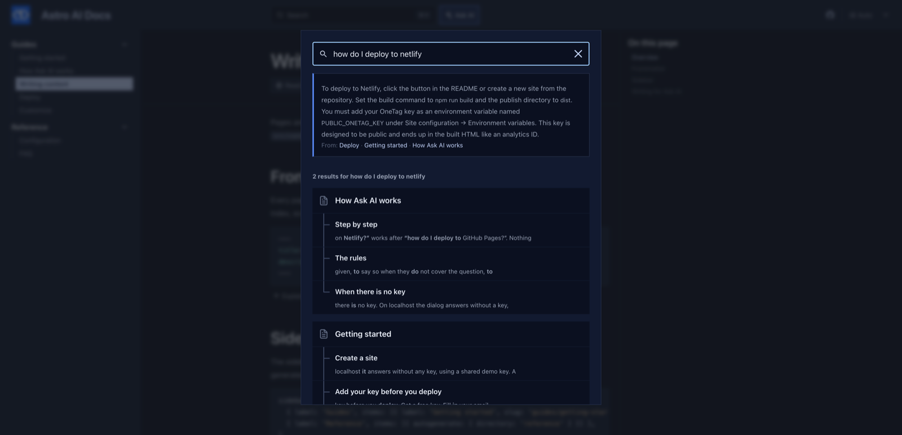

# starlight-onetag-search

AI answers inside the [Starlight](https://starlight.astro.build) search dialog. Readers type a question in the search box, click **Ask AI**, and get an answer from your docs right above the Pagefind results, with links to the pages it came from.



- No new button in your header: it lives in the search dialog readers already use.
- Retrieval uses the Pagefind index Starlight already builds. No extra service, no indexing step.
- Answers in the language of the question.

Live demo: the [Astro AI Docs](https://fengyiqicoder.github.io/astro-ai-docs/) template runs every starlight-onetag plugin.

## Install

```bash
npm install starlight-onetag
```

This plugin ships inside the [`starlight-onetag`](https://www.npmjs.com/package/starlight-onetag) package (0.2.0 and later) as `starlight-onetag/search`. This repository holds its source and docs.

```js
// astro.config.mjs
import { defineConfig } from "astro/config";
import starlight from "@astrojs/starlight";
import starlightOnetagSearch from "starlight-onetag/search";

export default defineConfig({
  integrations: [
    starlight({
      title: "My docs",
      plugins: [starlightOnetagSearch()],
    }),
  ],
});
```

Run `astro build && astro preview` to try it with answers drawn from the whole site: the Pagefind index only exists after a build.

## Before you deploy: get a free key

On localhost it works without a key, on a shared demo key. A deployed site needs its own: pass it as `starlightOnetagSearch({ key: "ot_..." })` or set `PUBLIC_ONETAG_KEY` in `.env`. Without one, readers see a line saying AI is not set up, and the build prints a warning.

Fill in your email at [onetagai.com](https://onetagai.com/?ref=starlight-onetag-search), or run this; the key arrives in that inbox (one key per email, 1,000,000 free tokens a month):

```bash
curl -X POST https://onetagai.com/api/signup -H "Content-Type: application/json" -d '{"email":"you@example.com"}'
```

The key is designed to be public, like an analytics ID: it ends up in the built HTML and can only spend that account's allowance. One key works for every starlight-onetag plugin on the site.

## Options

| Option | Default | What it does |
| --- | --- | --- |
| `key` | `""` (or `PUBLIC_ONETAG_KEY`) | The OneTag AI key. |
| `label` | `"Ask AI"` | Text of the row above the results. |
| `minChars` | `3` | Shortest query that shows the row. |
| `rules` | see `index.js` | Instructions given to the model. |
| `topPages` | `5` | Pages retrieved per question. |
| `perPage` | `5000` | Characters kept from each page. |
| `maxContext` | `20000` | Characters of page text sent per question. |
| `maxTokens` | `400` | Answer length cap. |
| `site` | `https://onetagai.com` | Where the API lives, for self-hosted deployments. |

## How it works

1. The question is split into keywords and searched in Pagefind one by one; pages are ranked by how many keywords they match. In `astro dev` there is no index, so `llms-full.txt` (if you use [starlight-llms-txt](https://github.com/delucis/starlight-llms-txt)) or the current page is used.
2. The top pages and the question go to OneTag AI from the browser; the answer streams in above the results, followed by the pages it used.

The plugin adds no component overrides, so it works next to any other Starlight plugin or custom component. The AI code is a separate chunk loaded the first time a reader uses the feature; page speed stays where it was. Nothing is stored on a server: OneTag AI keeps token counts and timestamps, not page text or questions.

## More AI for Starlight

- [starlight-onetag](https://github.com/fengyiqicoder/starlight-onetag): Ask AI dialog next to the search box, answered from your pages
- [starlight-onetag-translate](https://github.com/fengyiqicoder/starlight-onetag-translate): "Read in <your language>" button: AI translation of the page for the reader
- [starlight-onetag-explain](https://github.com/fengyiqicoder/starlight-onetag-explain): "Explain this code" under every code block
- [starlight-onetag-summary](https://github.com/fengyiqicoder/starlight-onetag-summary): "Summarize this page" box at the top of long pages
- [starlight-onetag-selection](https://github.com/fengyiqicoder/starlight-onetag-selection): select any text, click Ask AI, get it explained in context

## License

MIT. Powered by [OneTag AI](https://onetagai.com/?ref=starlight-onetag-search).
